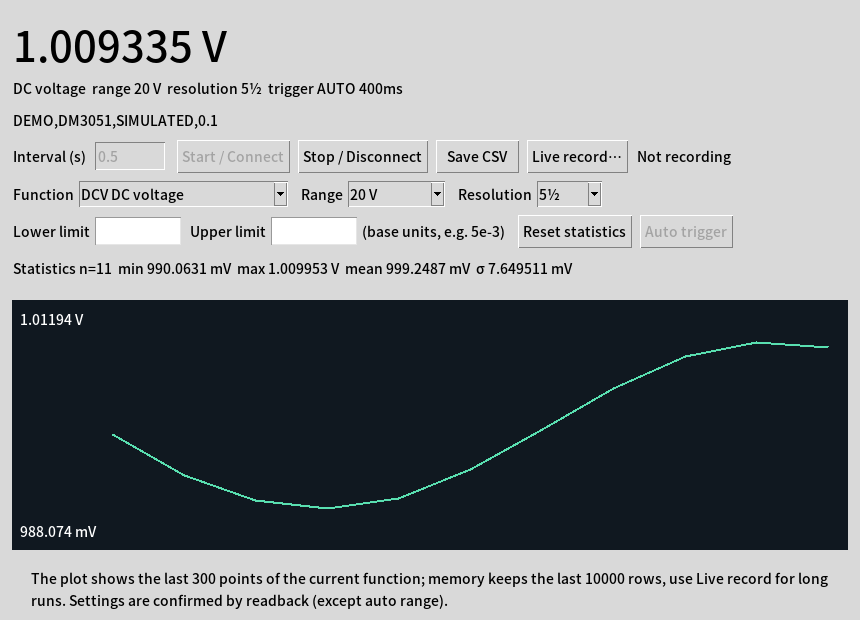

# dm3051-linux

Linux software for the **RIGOL DM3051** bench digital multimeter. It gives you live readings, a trend plot, statistics, limit alarms and CSV logging in a small Tk window. A command-line mode covers readings, statistics, settings and CSV logging without a display; the plot and the limit alarms are GUI-only.

RIGOL no longer supports this model. Its USB interface also does not work with standard VISA/usbtmc, because it speaks an older, non-standard framing. This project talks to the meter directly through libusb and implements that framing. It was worked out on a real DM3051 running firmware 03.03.



## Features

- **All 12 functions:** DC/AC voltage, DC/AC current, 2- and 4-wire resistance, frequency, period, continuity, diode, capacitance and voltage ratio.
- **Follows the front panel:** switch functions on the meter and the software notices.
- **Remote control:** function, manual or auto range, resolution (4½ / 5½ / 6½), and switching the trigger back to auto. Every setting is confirmed by reading it back from the meter, except auto range, which the firmware cannot report.
- **Statistics and alarms:** min / max / mean / σ, plus upper and lower limit alarms.
- **CSV logging:** rows are written and flushed one at a time, so a crash loses nothing. Overload and open circuit leave the value empty and keep the raw reply.
- **Honest data:** the software never invents a reading. Held values under single trigger, misplaced replies and readings taken while the function changed are all rejected.
- **No hardware needed to try it:** `--demo` mode runs a simulator that mimics the meter's SCPI behaviour (busy replies after switching, firmware names, range clamping, open-circuit value). Timing and USB-level quirks such as late replies and EIO are covered by unit tests, not by the simulator.

## Quick start

On Arch Linux:

```sh
sudo pacman -S --needed python python-pyusb libusb tk
git clone https://github.com/ArchitektSpeer/dm3051-linux.git
cd dm3051-linux

# let the desktop user access the meter (this device only)
sudo install -m 644 udev/70-dm3051.rules /etc/udev/rules.d/
sudo udevadm control --reload-rules
# now re-plug the meter

python3 -m dm3051            # GUI
python3 -m dm3051 --demo     # GUI with the simulator, no meter needed
```

On other distributions, install libusb and Tk from your package manager and `pip install -r requirements.txt` in a virtual environment. [docs/INSTALL.md](docs/INSTALL.md) covers this, plus SSH/headless permissions.

## Command line

```sh
python3 -m dm3051 --list                                   # find the meter
python3 -m dm3051 --cli --count 100 --interval 0.5 --csv run.csv
python3 -m dm3051 --cli --function 2WR --range AUTO --resolution 2
python3 -m dm3051 --status                                 # current settings as JSON
python3 -m dm3051 --trigger AUTO --configure-only          # leave single-trigger mode
python3 -m dm3051 --query '*IDN?' --trace                  # one query, with packet log
```

`--function` takes DCV ACV DCI ACI 2WR 4WR FREQ PERI CONT DIODE CAP RATIO. All options are listed in [docs/INSTALL.md](docs/INSTALL.md#options).

## Python API

```python
from dm3051.usb_device import DM3051

with DM3051.open() as meter:
    meter.set_function("DCV")
    r = meter.measure()
    print(r.value, r.function.unit)   # value is None on overload / open circuit
```

[docs/DEVELOPMENT.md](docs/DEVELOPMENT.md) has the full API, the exception hierarchy and the function/range table.

## Status

Version 0.2.2 has been tested on one DM3051 (firmware 03.03.00.03.02.00) under Arch Linux with Python 3.14, PyUSB 1.3.1 and libusb 1.0.30.

| Area | State |
|---|---|
| Connecting, identity, panel tracking, CSV logging | Verified on hardware |
| Function switching and readings for all 12 functions | Verified on hardware (leads open and shorted) |
| Range and resolution setting with readback | Verified on hardware |
| GUI on the real meter | Verified: live record matched the export row for row |
| Accuracy against known resistors, capacitors and diodes | **Not yet tested** |
| Unplugging the meter mid-session | **Not yet tested** |

Other firmware versions and the related DM3058/DM3068 are untested. Reports are welcome; please include the `--trace` log.

## Things worth knowing

- **Only one program can talk to the meter at a time.** A second one gets `Resource busy`.
- **`Input/Output Error` right after power-up:** the program resets the USB port once by itself. If that fails, power-cycle the meter. See [docs/TROUBLESHOOTING.md](docs/TROUBLESHOOTING.md#inputoutput-error-eio).
- **Capacitance is slow.** Each reading takes about 3 s, and longer for large capacitors.
- **Single or external trigger:** sampling is refused, because the meter would just repeat a held value. Use the GUI's *Auto trigger* button or `--trigger AUTO`.
- **Resistance, continuity, diode and capacitance drive a current out of the input jacks.** The GUI asks for confirmation before switching to them.

## Documentation

| File | Contents |
|---|---|
| [INSTALL](docs/INSTALL.md) | Dependencies, udev rules, every command-line option |
| [PROTOCOL](docs/PROTOCOL.md) | The legacy USB framing byte by byte, and every firmware quirk found so far |
| [DEVELOPMENT](docs/DEVELOPMENT.md) | Code layout, threading model, API, function table, how to add a control |
| [TESTING](docs/TESTING.md) | Unit tests and the hardware acceptance log |
| [TROUBLESHOOTING](docs/TROUBLESHOOTING.md) | Errors and what to do about them |
| [CONTROL-ROADMAP](docs/CONTROL-ROADMAP.md) | Coverage of the SCPI command groups, and what's next |
| [SOURCES](docs/SOURCES.md) | Manuals and the projects consulted |

## Development

```sh
python3 -m unittest discover -s tests -v    # 43 tests, no hardware needed
```

The real meter and the simulator share all measurement and settings logic. Only the byte transport differs, so most behaviour can be tested without hardware.

## License

MIT; see [LICENSE](LICENSE). Not affiliated with RIGOL. "RIGOL" and "DM3051" are used only to identify the hardware.
